<picture>
  <source media="(prefers-color-scheme: dark)" srcset="src-tauri/icons/icon-dark.png">
  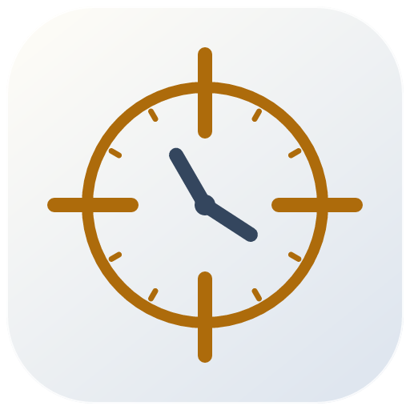
</picture>

# Chronoscope

See your data across space and time. Explore linked maps, tracks, charts and tables, with analysis calculated locally.

[Get started](docs/USER-GUIDE.md) · [Build and platform status](docs/INSTALLATION.md) · [Demo data](samples/README.md) · [CLI & MCP](docs/CLI-MCP.md)

<!-- Selected showcase: original simple-gallery picture numbers, in owner-selected order. -->
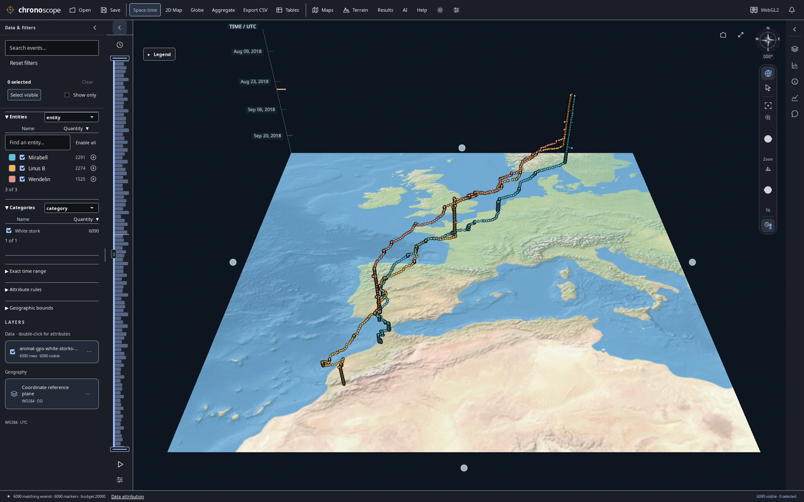

**A migration drawn through time** — Three white storks from Europe to North Africa; height encodes UTC time, not altitude.

## A closer look

Sixteen selected views from the October 22, 2026 capture set. Open any image for its full 1920 × 1200 resolution. [Data credits and capture provenance](assets/screenshots/showcase/README.md).

### Follow recorded journeys

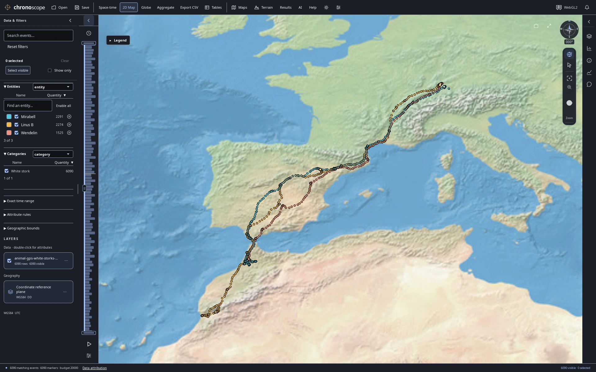

**Three birds, three journeys** — The same 6,090 recorded GPS fixes in a 2D map, colored by bird.

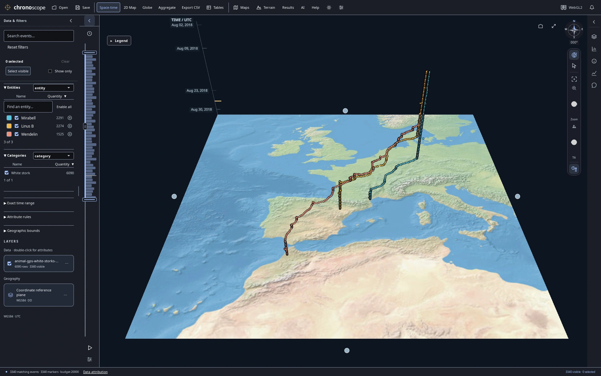

**August departure** — Narrow the time window to August: 3,340 matching GPS fixes from the stork dataset.

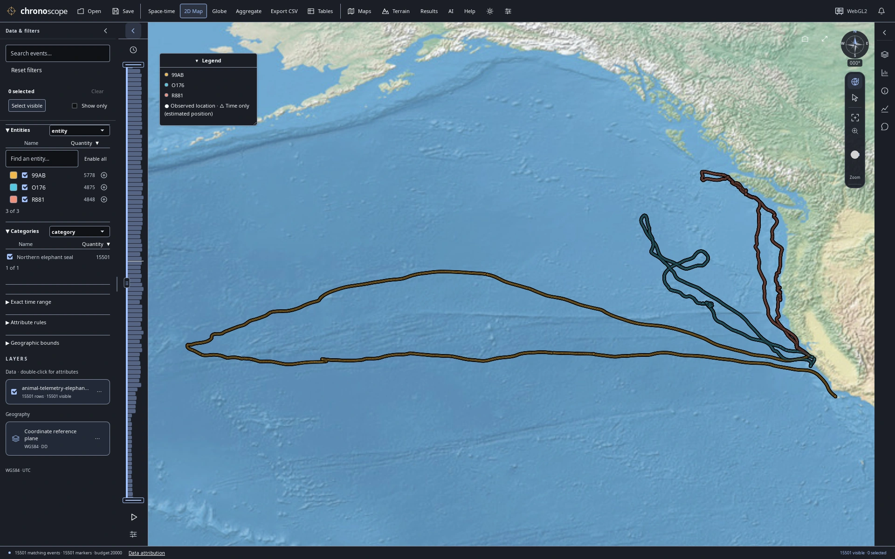

**Ocean journeys** — 15,501 published dive summaries from three elephant seals; positions are modeled dive starts, not underwater paths.

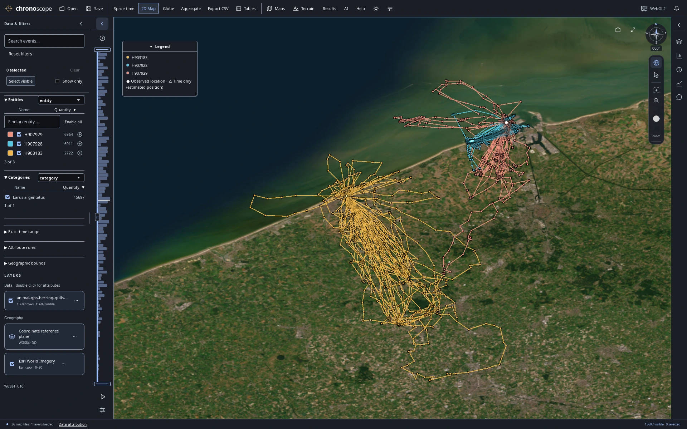

**Along the Belgian coast** — Three herring gulls along the Belgian coast. Connected GPS fixes do not establish continuous routes.

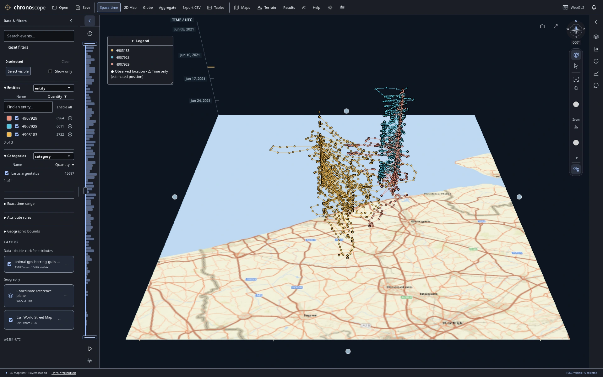

**Coastal movement through June** — Follow the same June 2021 gull observations through time, with UTC time on the vertical axis.

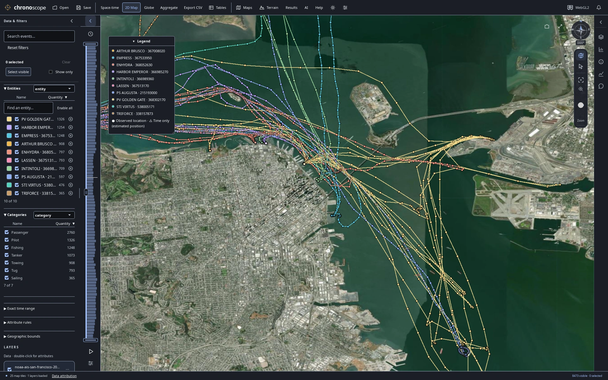

**Approaching the waterfront** — San Francisco Bay vessels over satellite imagery: recorded AIS samples, not independent voyages. Not for navigation.

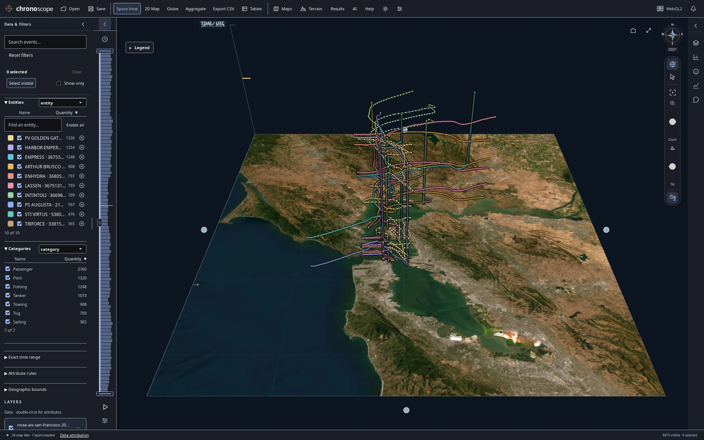

**A day of traffic in three dimensions** — Raise a day of Bay traffic by UTC timestamp to separate movement through time.

### Compare recorded measurements

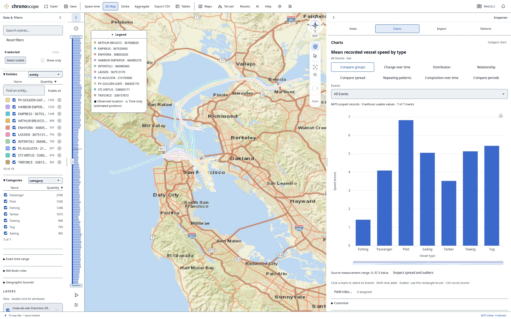

**Vessel types and recorded speed** — Compare recorded vessel speed by vessel type alongside the map and source records.

### Explore the planet

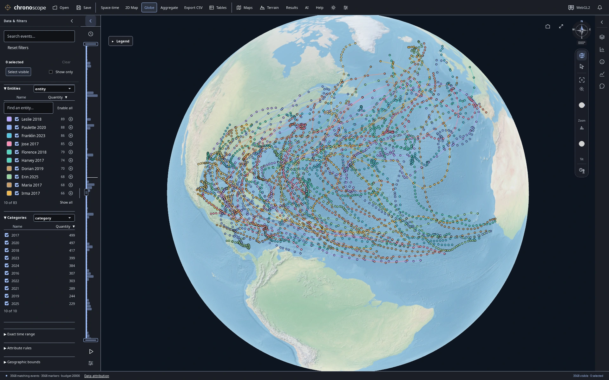

**A decade across the Atlantic** — 3,568 NHC best-track observations connect 83 Atlantic storms from 2016–2025; reported wind is in knots.

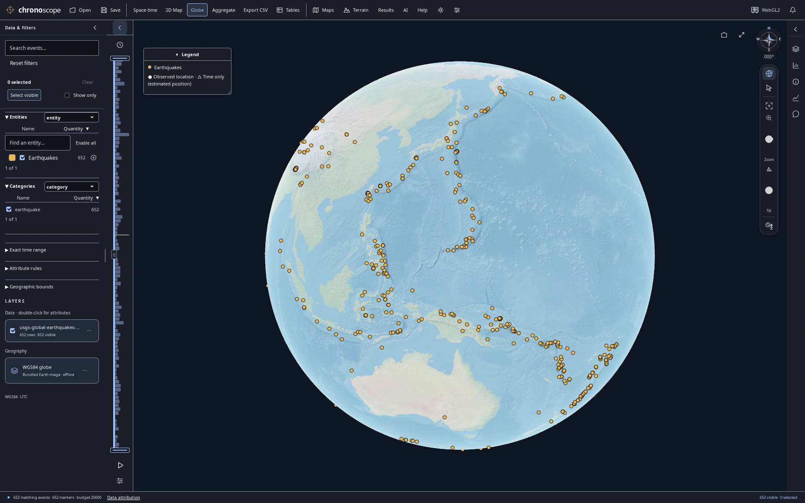

**The Pacific Ring of Fire** — USGS January 2025 earthquakes of reported magnitude ≥4.5. Surface epicenters, not depth; one hemisphere is visible.

### Read patterns in published reports

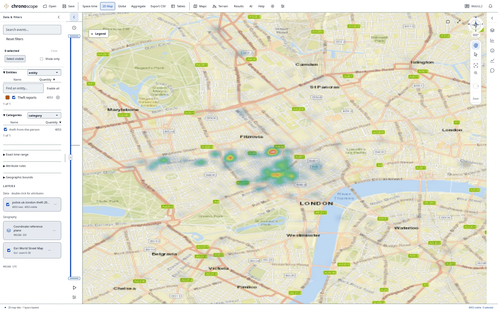

**London heat map in daylight** — 4,053 Police.uk theft-from-the-person reports, smoothed at this zoom. Locations are approximate and dates resolve to the month—not population-adjusted risk.

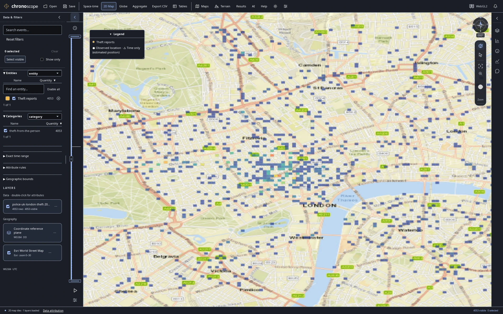

**Published reports as count cells** — The same published reports as display-grid counts. Cell colors summarize source records, not independent risk measurements.

### Keep charts beside the map

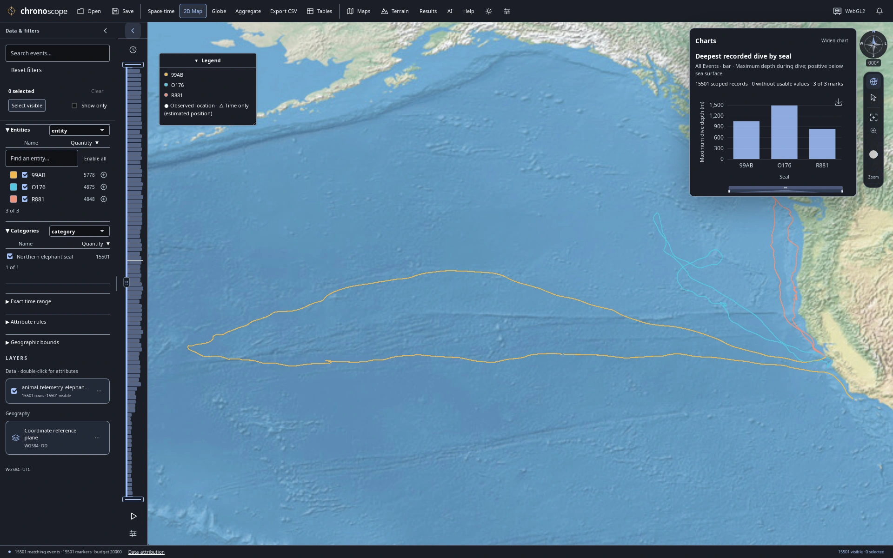

**Dive depths beside ocean tracks** — Keep a maximum dive-depth comparison beside the ocean tracks; depth is a recorded attribute, not map height.

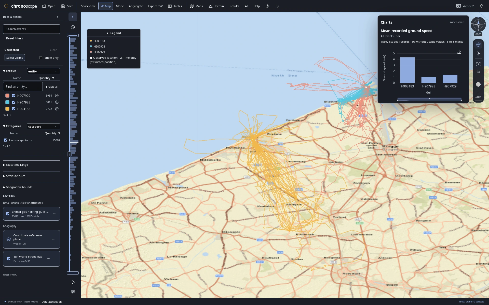

**Coastal GPS with a compact speed chart** — Inspect recorded gull speed alongside the coastal GPS fixes in a compact linked workspace.

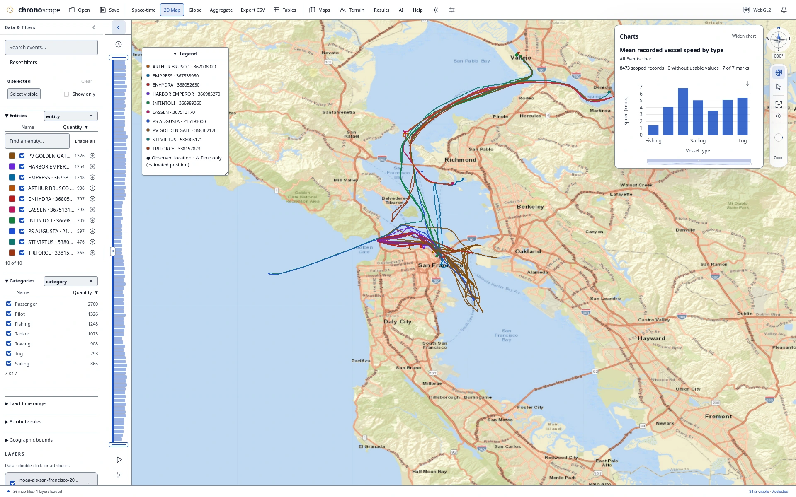

**Bay traffic with a compact comparison** — Compare vessel types and recorded speeds while keeping Bay traffic and the original records in view.

Time heights, tracks and density colors describe recorded samples, not physical altitude, continuous routes or independent activity. [Data, map credits and interpretation](assets/screenshots/showcase/README.md).

Open a bundled demo from **Help → Demo datasets**, or import CSV, TSV, Excel or GIS files. Filter, select, chart and save a portable `.chronoscope` project. Optional SI chat and CLI/MCP tools use the same analysis engine. [Features and guides](docs/USER-GUIDE.md) · [Privacy](PRIVACY.md).

**Source: 0.15.2, unreleased.** This standalone repository starts with one fresh source-snapshot commit; earlier Git history, pull requests, tags and releases are not included. **No binaries have been published in this clean repository yet; build from source.** [Platform status](docs/INSTALLATION.md) · [Changes](CHANGELOG.md).

Build with Rust 1.90+, Node 22+ and [platform prerequisites](docs/INSTALLATION.md):

```sh
npm --prefix frontend ci
npm --prefix frontend run build
cargo run --locked -p chronoscope-desktop
```

On Mac, `./script/build_and_run.sh` builds and opens a local app bundle. [Local verification](docs/VALIDATION.md) · [Contributing](CONTRIBUTING.md) · [Support](SUPPORT.md) · [Security](SECURITY.md).

Application code: **MIT**. Data and dependencies retain their own terms. [Licenses and attribution](THIRD_PARTY.md).
