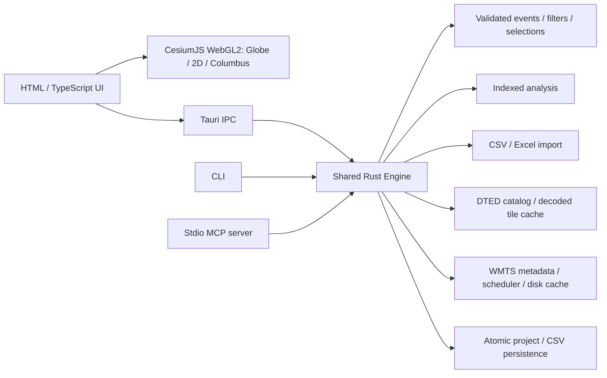

# Chronoscope architecture

The Rust library is the single domain implementation. `Engine::invoke` supplies commands to Tauri, CLI, MCP and the explicitly enabled authenticated development bridge. Frontend code handles presentation, camera and pointer interactions; it does not duplicate coordinate or analytical algorithms. Desktop Tauri uses IPC and local bundled assets, with a restrictive CSP and file-dialog capabilities. The desktop opens no server by default. Opt-in SI agent access starts an authenticated ephemeral loopback bridge to this same engine; the CLI translates standard MCP stdio to the private HTTP hop. The browser development bridge remains separate.

The desktop CSP permits local scripts and WebAssembly compilation (`'wasm-unsafe-eval'`), without JavaScript `'unsafe-eval'`. A narrow Vite pre-transform replaces the pinned Cesium Knockout dependency's global-object `eval` discovery with `globalThis` in production and development dependency builds. The transform requires exactly the reviewed source occurrence and fails the build if an update changes it; it does not broadly rewrite application scripts or relax the policy. The main browser parity test installs this same response-header CSP and records policy violations.

## State and concurrency

`SceneState.view_states` stores independent navigation for Time, Map and Globe. Visited views retain their exact Cesium camera; a one-shot sync instead stages geographic focus, heading, tilt, ground scale and visible ground corners for the other projections. The next visit fits that footprint using the destination camera, keeping Map flat. Camera vectors are never copied directly between projections. Corner rays that miss an Earth overview use its conservative geographic bounds. Legacy files have no cached views; document replacement clears the previous cache. Rust bounds and validates the three mode keys, geographic coordinates, footprint size and optional camera vectors before portable persistence. Demo thumbnails are renderer captures from the bundled saved views; their asset manifest records public source attribution, view state and image hashes.

The `Welcome` frontend controller owns the empty unsaved-workspace surface and up to eight recent portable-workspace paths in device-local browser storage. It routes Open and demo actions through existing document guards, hides the underlying workspace from keyboard navigation while visible, and does not store dataset contents. Recent paths are recorded only after successful Open or Save; the user can clear the list. Identical in-flight WMTS viewport requests share a load; a direct refresh promotes a page-yielding camera request to complete the viewport. Only canvases with loaded or overlapping seeded content are published, and cancellation invalidates the shared load.

A shared engine state mutex protects metadata and an indexed SQLite connection; an operation gate serializes workspace calls so batches, dry-runs and expected-revision checks are atomic. Events live in a private disposable working database, not a cloned Project Vec. The current Project stores metadata/filter/selection/context. Row edits journal before/after payloads under SQLite savepoints; failed or interrupted operations restore both database and metadata. Normal navigation does not consume data undo. Replacement imports/open retain at most three prior disk stores, and edit history has count/context/journal budgets. Saving a database excludes history, merges the search index and vacuums the backup so removed payloads do not ride along in a shared file. Small version-3 ZIP files remain compatible.

Indexes cover identity, time/interval end, entity tracks, category, source, values and original attributes. RTree narrows spatial queries, including dateline bounds, with exact DD tests after candidates. FTS5 trigram LIKE narrows substring search; Unicode-aware functions retain the domain's case/numeric semantics. Four LRU ordered-result tables use indexed positions, avoiding repeated sorting or deep OFFSET scans. Schema/summary caches avoid repeated source-column discovery and histogram/statistic work. Field projections fetch canonical columns or requested attributes without decoding unrelated source payloads. Render/analysis inputs use compact columns. A 32 MiB SQLite page cache and disk temporary tables bound event-cache memory.

Tauri calls run on blocking workers. A separate terrain mutex protects lazy tile sampling; a global map scheduler bounds concurrent HTTP misses and optionally paces starts. Asynchronous jobs have a bounded registry and nonblocking status/result/cancel endpoints outside the workspace operation gate. Job workers clone Engine handles (shared Arc state), not events or an independent workspace. Requests use thread-local cooperative cancellation/progress contexts; SQLite instruction hooks, CSV loops, analysis loops and tile boundaries check interruption. Rust HTTP body/request waits check cancellation every 25 ms. Native OS/card middleware can still delay interruption. Detached map, coordinate, terrain and analysis calls release the workspace state/gate before slow work; analysis carries the revision of its captured input. Native canvas rendering can continue while a Rust worker runs.

Workspace loading and committed-change publication are shared in `engine/workspace.rs`. Startup, Open and recovery enforce the same GIS package checksums, resource limits and effective file-root policy. Terrain preferences and catalogs are staged before publication; a failed settings write keeps the prior catalog and revision. Result creation/removal uses the normal lifecycle and desktop notification finalizer.

Each live document has an opaque session identity plus a replacement epoch. SI requests and background jobs capture it before waiting on a model or operation gate. Mutations recheck it while holding the gate; undoing a document replacement advances the epoch even when the prior database returns. This identity is independent of revision, so ordinary filters/edits do not rebind a request to another document. `snapshot.workspace_id` and optional mutation `expected_workspace` extend the same check to submitted frontend edits.

The frontend `EditorController` owns dirty fields and immutable submissions outside the DOM; parsing a timestamp cannot read values from a subsequently refreshed or retargeted form. `WorkspaceController` joins concurrent save/autosave/close operations and waits for submitted edits before applying the existing unsaved-work policy. Rendering templates, controls and layout remain in the presentation layer.

Desktop attachment is explicitly enabled for a selected canonical filesystem root. A random bearer credential and private connection descriptor identify the loopback service; browser Origins are rejected and session IDs separate simultaneous clients' request IDs. Engine notifications refresh the GUI and semantic view changes restore display state. Canvas capture uses a bounded request/reply channel that bypasses the operation gate for GUI responses; standalone capture reports unavailable. Logs are bounded and exclude request arguments/event fields/tokens. Job and idempotency registries are session-local, with disclosed retention budgets.

## Frontend workflow boundaries

`main.ts` composes the workspace. `import-dialog.ts` owns import drafts and source/mapping/review steps; `guided-analysis.ts` owns the four local analysis starters. `map-settings.ts` owns basemap, server, layer, authentication and cache dialogs through explicit host accessors. `table-selection.ts` serializes mouse/keyboard gestures and retains exact IDs and range anchors. `workspace-files.ts` routes Open/export requests; `WorkspaceController` remains responsible for save/autosave/close serialization. `operation-job.ts` polls, cancels and releases engine jobs, waiting for their actual terminal outcome so a late cancellation cannot be reported as a rolled-back commit.

Full import review is separate from commit. `engine/imports.rs` uses the existing bounded decoder and disposable indexed store to count valid/rejected records, location gaps and canonical duplicate candidates. The full source is checked before and after processing. UI rejection examples stay bounded; report export streams every rejected row, original cells and reason into a formula-protected temporary CSV and atomically publishes it only after successful validation/cancellation checks. Report paths use the existing file-root policy, refuse source/symlink replacement and require explicit overwrite permission. Reviews never publish Events, alter source values or change document history.

## Data and import

Stable `u64` IDs join selection, evidence and edits; JavaScript and MCP receive IDs as decimal strings to preserve values beyond JavaScript's exact integer range. Events retain WGS84 DD locations, UTC fractional-second intervals encoded as binary64 epoch seconds, entity/category/label/value, original source attributes, related entity, analyst notes/tags and filename/sheet/row provenance. Canonical edits leave imported source attributes unchanged. Projects use a version-6 manifest with float round-trip parsing in portable `.chronoscope` ZIP bundles. Typed scene/display state and workspace settings retain the actual renderer camera, layout and map configuration. Loaded DTED is embedded; archive entries/expanded sizes/resource consistency are checked before staging extraction. SHA-256 bundle content keys reuse terrain extraction directories. Version-1/2 workspaces migrate with defaults for new source/view/table state. Legacy JSON loads preserve saved timestamps and migrate metadata. Save uses temporary files and atomic replacement.

Import separates bounded file decoding (`csv`, `calamine`) from semantic mapping and reject review. UTM/MGRS convert in Rust via `mgrs-convert` (Krüger/Karney projection series and NGA MGRS grids; independently tested against PROJ/GEOTRANS); canonical analysis always uses DD, independently of display projection. Excel date systems are decoded by calamine. Workbook declared and actual expanded bytes are checked before workbook parsing. These are resource limits, not an OS process sandbox.

## Rendering

The engine sends a packed little-endian binary render packet: longitude, latitude and timestamp as Float64, entity index as UInt32, value as Float32, stride 32. Base64 transports the bounded packet through common IPC/JSON interfaces. Cesium converts geographic positions to its native ellipsoid/projected representation and GPU position encoding. In Points mode, the packet contains at most 20,000 uniformly spaced time-order representatives by default, with an explicit 100,000 option and exact located_count/rendered_count/LOD disclosure. A bounded selected-evidence reserve keeps individual table/agent selections visible within LOD. Exact query/aggregate/selection does not use this packet. Point/billboard collections, native line primitives and a separate selection collection batch presentation without one Cesium Entity per row. Scene rebuilds are event-driven; camera interaction continues locally while debounced regional packets refine representative data. Extra viewport bounds intersect semantic filters, preserving exact filtering and revision checks.

CesiumJS 1.146.0 owns all geographic rendering: a native WGS84 globe, orthographic 2D and Columbus-view space-time. Rust still computes all exact data queries, selection and display summaries. Native Cesium point/billboard/polyline collections and bounded geometry primitives avoid one Entity per source row. Ground effects use bounded worker-generated atlases on Cesium imagery layers; bloom only derives from event contributions. Camera state is explicitly tagged `renderer: cesium` and stored as validated `cesium_camera` position/direction/up plus optional 2D frustum width; legacy Three camera vectors are not interpreted as Cesium coordinates. CLI/MCP fit and mode changes discard stale camera state. Geographic coordinates, timestamps and source elevations are never rewritten for display.

Cesium workers/assets, the low-resolution NASA reference image and the NGA EGM96 grid are local build assets. No ion token, CDN or second map proxy is required. Rust retains map downloads, smartcard authentication, caching, server/layer zoom rules and attribution. A custom local imagery provider feeds those pixels to Cesium; local DTED feeds a bounded terrain provider. Terrain datum selection is explicit: EGM96 orthometric heights use `h = H + N`, ellipsoid heights need no geoid addition, and unresolved MSL remains undisplayed. See [parity obligations](CESIUM-PARITY.md) and [geoid provenance](../frontend/src/assets/egm96-15-NOTICE.txt).

Raster headers are checked against the compositor's dimension budget before frontend decoding. EPSG:4326 source imagery is resampled into the intermediate Web Mercator mosaic; the local Cesium imagery provider converts those cached pixels to native quadtree tiles without requesting a server directly. The compositor clips raster coverage to ±85.0511287798066°. This is separate from event geometry: native WGS84 geographic flat modes and Globe retain polar coordinates and picking. The 2D camera is orthographic with rotation disabled and no time-axis objects; Columbus space-time uses explicit timestamp display heights.

Globe uses native WGS84 ECEF positions and ellipsoid occlusion checks for picking. Long globe segments use bounded per-edge GeographicLib/Karney geodesic interpolation rather than straight chords through Earth. Local DTED enters Cesium through quantized terrain tiles with source-resolution LOD, a bounded tile cache and explicit void triangles. Native imagery layers follow that surface. Source heights remain MSL; the selected EGM96 model adds geoid undulation for ellipsoid display, while unresolved MSL is not shown. Camera changes refine regional WMTS and intersecting local terrain coverage; no external global elevation service is implied. A global dateline dataset currently uses a wide min/max frame; WMTS viewports must not cross the dateline.

Geodesic expansion shares a 200,000-added-vertex budget across all WKT boundaries and another 200,000 across all tracks/trails, rather than granting each edge a fresh budget. Combined with the 400,000 source-endpoint presentation budget, these streams remain bounded to 800,000 vertices. Measured endpoints are retained; interpolation is distributed across remaining edges and becomes coarser when needed. Diagnostics disclose interpolated and coarsened counts. Exact source geometry and analysis are unchanged, but a budget-limited long globe segment can visibly approximate its surface arc.

In native 2D and Columbus, geographic viewport bounds come from the intersection of the camera's complete frustum with a finite projected-world prism, including supported date-line copies. The ground prism includes terrain height; the data prism additionally includes the temporal display height. This preserves visible elevated events when Cesium's globe `computeViewRectangle` is unavailable and avoids arbitrarily expanding a ground rectangle for time-axis data. Camera zoom requests progressively finer backend cells and exact records within this data footprint; semantic filter totals remain unchanged. Globe continues to use its native geographic view rectangle.

## Reversible display LOD and effects

`display_data` derives exact bins in Rust/SQLite after semantic and viewport filters. It requests a hierarchical projected grid and UTC slabs, coarsening until the cell/time budget holds without dropping counts. Default Auto clusters above 2,000 located records; a coherent `view_snapshot_v1` then sends only bounded selected individual evidence alongside the cell packet. Source rows stay indexed and unchanged. SceneState stores validated display options; `view_set`/`scene_sync`, portable files and named views share that representation. Cell descriptors bind their viewport, time slab and optional entity/source partition. Query/table/single-cell selection resolve exact members; multi-cell selection uses one temporary key table and exact SQL union. Summary positions are explicitly not measurements.

Base grids use the bounded summary cache. Selection overlays look up indexed IDs before exact point bounds; they avoid a quadratic SQLite id/rowid-IN intersection. Spatial selected queries use a semijoin when appropriate. Camera reads are single-flight and coalesce latest bounds; stamp/generation checks reject stale publication. They do not interrupt a synchronous SQL call already running. Async display_data jobs use the normal operation cancellation and SQLite progress hook.

`DisplayLayer` batches clusters into a native point collection with at most 80 labels and exact cell descriptors for picking. Space-time density uses native per-instance colored cell geometry at its UTC slab height; ground density uses a bounded imagery atlas. Heat uses a replaceable worker for raster splatting and separable triangular smoothing, with clearly labelled approximate overlap units. Native Cesium imagery layers place ground effects over the ellipsoid or selected local terrain. Replaced geometry, imagery and workers are disposed with stale-generation guards. Trail simplification protects endpoints, selected evidence and inferred triangles and has an explicit linear work fallback. Dense cell centers never become inferred routes.

Optional bloom derives bright-pass, blurred glow and additive contributions from the bounded event-weight atlas in a worker. It does not enable Cesium's whole-scene bloom stage: elevated events, imagery and the scene background never enter the emission input. Heat and bloom combine the filtered time window on native ground imagery layers even in space-time; time-height controls do not raise them. Source events retain their bounded time-height rendering and exact original data. Actual pixel comparisons with markers/tracks hidden verify visible effects separately from resource diagnostics. Heat map and bloom are both off by default. See [display semantics and performance limits](DISPLAY-SCALING.md).

## Deactivated browser-extension experiment

The earlier loopback broker (`src/webmcp.rs`) and MV3 extension (`browser/webmcp-extension/`) are retained behind `experimental-browser-webmcp`, a non-default developer build feature. Standard builds contain no Browser field/runtime, register none of its host commands, omit it from generated frontend contracts and report `mcp_client.browser_webmcp: false`. The app has no browser setup controls, help topic, pairing prompts or export action. Normal inbound MCP and outbound stdio/Streamable HTTP are unchanged.

The intended future direction is direct, extension-free WebMCP website access by Chronoscope's SI through a suitable browser runtime and agent integration. An SI provider connection alone does not supply that browser integration. It is not implemented in this release. [Archived implementation and opt-in tests](../browser/README.md).

## Terrain and maps

New profiles select bundled Balanced world terrain: a one-arc-minute EGM96 grid derived from USGS GMTED2010. Independently compressed 256² blocks stay compressed on disk; a sixteen-block decoded LRU is bounded to 2 MiB. Broad viewport requests use decimated overview levels. Ocean-only blocks are absent and return zero, while source land voids remain absent. User DTED replaces the built-in source. An explicit unload persists; older preferences without `terrain_builtin` retain their existing choice. Portable workspaces retain built-in identity without copying the world pack. See [source and packaging](../assets/terrain/README.md).

The DTED catalog reads bounded UHL/DSI/ACC metadata and indexes intersecting degree cells. Record elevations decode lazily into signed 16-bit buffers; at most four tiles are retained (about 104 MiB for four maximum-size DT2 tiles). Each record validates ordering and checksum, negative values use signed magnitude, voids remain absent. Sampling is bilinear and favors finer overlapping tiles. Mesh queries group samples by source tile before decoding, avoiding repeated four-tile-cache eviction across wide grids. They generate uniform Mercator X/Y grids up to 257²; only nonvoid quadrilaterals become triangles. Source elevations retain DTED MSL semantics.

WMTS parsing follows capabilities matrix identifiers, scale denominators, origins, dimensions, layer links/limits and supported CRS axis order. Resolution selection honors the chosen matrix level, or the canvas pixel dimension for automatic selection. Tile plans and raster delivery are paged, with no testing-only viewport cap or silent resolution downgrade. Bounded worker batches overlap downloads; a per-resource lock deduplicates cache misses, with separate start pacing and server cooldown. Normal defaults are eight workers and no imposed delay. Native macOS helper IPC remains serial for client-authenticated requests. Cached entries use URL-derived SHA-256 names; capabilities/tiles have separate TTL and size limits. HTTP 429 imposes a cooldown and returns a recoverable error without retry loops. An atomic local settings file controls cache size (default 8 GiB, 0 unlimited), TTL, concurrency, optional pacing and offline mode. Cache size is counted incrementally; eviction scans happen only over quota, not once per tile. This is direct client disk caching, not a proxy/listening service. Cached imagery is separate from workspaces.

Imagery is cropped to the geographic viewport. The GUI requests eight tiles per asynchronous page and progressively composites decoded images into a canvas bounded to 4096 pixels per dimension; overlapping map layers share the existing CPU image budget. Each decoded source tile is released after painting. `RasterPacketImageryProvider` snapshots those pixels and supplies native imagery tiles from memory. A replacement can retain up to three bounded imagery layers until its textures are ready, preventing blank flashes while panning; obsolete providers/canvases are then released. Cesium drapes these imagery layers on the active ellipsoid or local DTED terrain. Supporting additional source CRSs requires real reprojection/sampling, not relabelling coordinates.

## Analysis and extension points

Proximity and clustering use a temporal sweep with Earth-centered spatial cells and exact WGS84 ellipsoidal geodesic comparisons (`geographiclib-rs`). Dense candidate work is bounded. Clusters are union-find connected components; stationary/speed/gap tools operate on observed adjacent samples. Findings carry evidence IDs and a revision; stale results are marked in the UI. These are observed-sample analyses, not reconstructed routes or confirmed meetings.

Commands are the extension boundary for future analysts, formats, terrain readers and GUI panels. CLI and MCP can invoke the same new operation once its schema is added. MCP tools use JSON-RPC stdio, protocol-only stdout, root-scoped canonical file paths and bounded requests. The authenticated development HTTP bridge binds loopback and exposes no permissive CORS. Neither file scopes nor Rust's unsafe prohibition replace OS sandboxing or dependency review.

Import recognition and minute parsing live in `import.rs` / `timestamps.rs`, shared by GUI, CLI and MCP. Detection samples bounded values, preserves source fields, refuses ambiguous numeric dates unless sampled evidence or overrides resolve order, and previews converted values. MGRS precision metadata persists separately from canonical DD centre coordinates. Help is authored once in `frontend/src/help.ts`; `scripts/export_help.mjs` exports the shipped Markdown guide. No help-network requests are required.

## Source layers and tables

Source filename/worksheet is the current layer identity. Snapshot counts use exact SQL aggregation; `Filter.hidden_sources` affects the common engine. `attribute_table` is a read-only paginated command (also an MCP tool), optionally scoped to one source and current filters. It returns canonical fields and up to 512 original attribute columns, retains string IDs, and sorts numbers numerically. Rows are sorted once into a cached indexed result; subsequent pages use position lookups. Original column discovery is cached per source. New sort/filter results and first summaries still do dataset-sized work; measured costs are disclosed in validation. Full independent styled layers are future work. Saved scene state includes table scope/sort and orthographic zoom.

## Ingestion and resource ceilings

CSV is scanned for a bounded sample/count, then converted in 1000-row batches into a staged SQLite database. File size/mtime changes invalidate preview tickets. No full RawTable/Event Vec is kept for CSV. The quote-aware record reader bounds logical records before csv can grow them indefinitely. Append stages a combined store rather than partially applying unreviewed input. Excel retains calamine's format-aware bounded workbook path; large streaming XLSX/XLSB readers are future work, not implied by the CSV design.

Portable database headers carry a Chronoscope application/schema identifier. Open uses a readonly source, rejects triggers/views, checks SQLite integrity, canonical payload/columns, attribute rows, FTS content/integrity, conservative RTree footprints and index definitions, copies into a fresh DELETE-journal destination before enabling WAL, and verifies/extracts embedded DTED checksums with strict names/size limits. Existing legacy JSON/ZIP loaders retain their archive safeguards. Private working directories use a held OS file lease; inactive directories older than a day can be reclaimed without removing active stores. Input/source files are not edited in place. Several working/backup/journal copies can require substantial disk; a small-memory engine is not a small-disk guarantee.

CSV ceilings are 2 GiB/50 million events/512 columns/1 MiB logical records. The demonstrated workload is one million rows, not the maximum. Database open ceiling is 32 GiB. Excel and small JSON/ZIP keep their existing limits. Context/history/agent outputs/jobs/rendering/analysis each have explicit budgets; exact full-corpus queries are separate from bounded visual/analytical outputs. Schema additions are the extension boundary; no arbitrary SQL or code execution is exposed to agents.

## Accuracy regression boundary

`tests/fixtures/gis-reference.json` is generated independently by Python PROJ/GDAL/GEOTRANS, without importing app formulas. Rust tests check projection/grid conversion, every MGRS precision, DTED point registration/interpolation and ellipsoidal geodesics. Current native Cesium tests independently check ECEF positions, original-grid EGM96 references, source-grid registration, holes, geodesic arcs and resource behavior. The original `gis-qa.mjs` Three.js mesh assertions have been removed; their recorded results are historical and do not certify the new renderer. The corpus covers UTM special zones, equator/signed zero, antimeridian and polar cases. See [GIS accuracy](GIS-ACCURACY.md) and the [current validation record](validation/cesium-prototype-2026-10-15) for actual passing checks and outstanding runtime limits.

Rust's terrain mesh is sampled uniformly in Web Mercator, which the native provider respects when interpolating source heights; it does not assume uniform latitude rows. The explicit vertical model converts EGM96 orthometric heights with `h = H × exaggeration + N`, leaving geoid undulation unexaggerated and source `H` unchanged. Unknown MSL stays undisplayed. Longitude crossings split flat trails rather than producing false cross-world edges. Rendering precision, source terrain resolution and the coarse geoid model do not establish survey accuracy; display lifts and temporal offsets are not measured altitude.

## Native WMTS TLS authentication

`wmts_auth` owns a locked, atomic, machine-local origin/identity store; `wmts_native` manages bounded IPC with the embedded macOS URLSession/Security helper. Mac builds compile this helper with the Xcode command-line Swift compiler. Windows delegates automatic client authentication to system curl/Schannel; Linux supports explicit PKCS#11 identities with compatible OS curl/middleware. Default authentication is automatic on macOS/Windows and requires no map profile. The engine scheduler, response limits and cache remain shared; auth scope rotates cache keys and metadata keys. No PIN/private-key material crosses the engine or project format. See [WMTS authentication](WMTS-AUTH.md).

## Assistant and streaming summaries (0.6)

`si::Assistant` is an optional outbound OpenAI-compatible HTTP client, separate from the opt-in inbound desktop MCP bridge. It has one active request per engine, a memory-only key and bounded conversation history, local nonsecret endpoint/model configuration and an optional connection-scoped file grant, bounded context/results/tool calls, progress and cancellation. It adapts the same MCP tool schemas to Chat Completions function tools and invokes the validated engine directly, avoiding process creation, shell escaping and an unnecessary HTTP/stdio round trip. Record-changing tools require `allow_edits`; filesystem tools additionally require a chosen root, enforced through the MCP scope helper. SI settings, keys and conversation never enter project state. The connection dialog configures only the provider; a separate `SIChat` component owns docked chat rendering and async job polling. Rust owns the history (32 messages / 96 KiB, complete-turn eviction) and exposes `si_history`/`si_clear`/`si_permissions`; legacy command names normalize before validated dispatch. Current workspace metadata accompanies each turn; old answers are not authoritative state. API endpoint redirects and insecure remote HTTP are rejected. No provider SDK or new dependency is needed. An in-flight network call has a 60-second deadline; a five-minute cooperative deadline also cancels indexed queries/imports. Async jobs expose progress to the UI and agent clients. Model responses are untrusted; unknown or unadvertised tool names cannot execute. Prompt instructions cannot enforce analytical correctness, so users must inspect tool evidence.

`aggregation::Accumulator` processes one converted record at a time into a disposable disk SQLite index with an 8 MiB page cache and 32 GiB file cap. Fixed UTC windows and entity/category/source partitioning define candidate groups. WGS84 geocentric cells are a conservative candidate filter across longitude discontinuities and poles; final membership uses GeographicLib ellipsoidal distance to the first anchor. Nontransitive anchored grouping avoids chains expanding indefinitely. This is order-dependent; import uses file order and loaded-workspace aggregation uses chronological order. Main ingestion never stores discarded raw member rows, though parsing still reads the whole source. Only group representatives and statistics enter the main event/FTS/spatial indexes. Replacement aggregation stages a new store and atomically swaps it through existing revision/history handling. There is no claim that aggregation preserves raw evidence; existing summaries are rejected as aggregation input. Unknown locations remain separate records. Summaries persist through existing Event attributes, without a format migration.

Render payloads remain stride-32 binary with additional `inferred_ids` and `inferred_markers` metadata. Missing records and exact visible bracketing anchors are found independently of LOD samples using the SQLite track index. The WGS84 geodesic estimate is render-only: SQLite coordinates, spatial predicates, distance analyses, exports and saved records remain null. Unbracketed and antipodal cases receive no map marker. Native point circles and camera-facing billboard triangles share picking/selection in all views; no observed-coordinate stem is drawn for triangles. Marker rendering and inferred samples obey the existing total marker budget. Native platform/GPU verification is distinct from browser software-GPU QA.

## WKT geometries (0.7)

`geometry` delegates OGC Simple Features grammar and topology validation to GeoRust `wkt` 0.14 and `geo` 0.31. Source WKT is canonical `Event.geometry_wkt`, retained with dimensions/SRID text. Only WGS84 X=longitude/Y=latitude and optional SRID=4326 are accepted; projected/different datums and CRS-definition WKT fail explicitly. Z/M do not control render height or timestamps. Resource guards bound text, vertex count and nesting before expensive operations. Topology validation rejects self intersections/open rings. Dateline-crossing segments must be explicitly split into multipart geometries; this avoids drawing a false edge across the world.

Only POINT has a scalar point location. Other types have true geometry and null scalar lat/lon, are excluded from point-distance algorithms, and never receive inferred time-only triangles. Existing RTree entries index full shape envelopes; exact GeoRust rectangle intersection post-filters candidates, including holes. Located-only filters include nonempty geometries; point rendering/bracketing use an explicit point predicate. SQLite v1 files migrate in the disposable working copy to v2 with a canonical geometry_wkt column verified against payloads. ZIP manifests use v4 when geometry is present (v3 otherwise); older ZIP/SQLite versions remain readable, while old app versions reject new geometry files instead of silently dropping shapes.

`render_geometries` streams bounded shape representations separately from stride-32 point packets, reporting total/limited/source-vertex counts and bounds. Native primitives batch lines, multipoints and hole-aware polygon fills where supported; terrain/globe retain boundaries rather than coarse fills cutting through relief. Filled geometry and segments participate in shared selection. Globe imagery uses native imagery providers over the bounded Rust-composited viewport mosaic, without a per-source-tile shader branch chain. Camera-driven requests refine that viewport and the loaded local DTED provider; they do not imply an external global terrain service. GPU memory, native geometry expansion and source-resource limits still apply.

## Lifecycle and contracts (0.8)

The command registry (`command.rs`) owns identity/effect metadata for transport discovery, transactions, dirty tracking and undo. `api.rs` defines serialized render/resource DTOs; their output schemas derive from Rust. Other operation schemas remain authored in `schema.rs` and `schema/output.rs`. `scripts/generate_contracts.mjs` generates the frontend command/argument/result types from the built CLI. Compile-only negative fixtures check exact string IDs, complete coordinates and nested jobs. Structured `EngineError`/`ErrorCode` values cross the Tauri and development HTTP boundary; CLI/MCP use the same classifier. Legacy internal String errors remain an incremental migration boundary, not a claim that every internal helper is typed.

`engine/recovery.rs` records dirty/source/checkpoint state. A weak-reference background worker commits workspace metadata into the existing working WAL database after a two-second quiet period, targeting thirty seconds while the operation gate is available. It does not copy all events. An atomic mode-0600 descriptor points to the leased private working database; checkpoints retain that directory after engine teardown. Portable save clears the checkpoint and dirty state. Recovery is same-machine protection; it is not an interchange file and does not retain undo/job/API credentials. Recovery alone reconciles stale selection/group references when later row deletions committed after checkpoint metadata. Ordinary portable opens reject inconsistent references. Explicit native discard removes the current recovery checkpoint. Active leases prevent cross-process recovery/deletion; cleanup preserves descriptors' referenced stores.

Dataset summaries/statistics have separate caches from selection histograms. Compact snapshots omit expensive statistics unless requested. Point selection reuses full-dataset statistics, except when selected-only filtering actually changes the input. Dense analysis counts every candidate visit, including same-entity skips; a single-entity proximity query returns its exact empty result without pair enumeration.

Automatic client-auth caches rotate online scopes at process launch and session reset. Offline mode explicitly reuses the previous scope. Confirmed-anonymous macOS responses can use a persistent public namespace; Windows automatic responses remain conservatively session-scoped because its curl boundary cannot attest which identity was used. Machine-local preferences/auth/cache are separate from portable workspaces. Assistant file permissions intersect nested roots and can never be widened by a broader enclosing MCP attachment.

Subsystem boundaries are explicit: recovery, derived-store validation, summary caches, error/command identities, output contracts and raster composition each have focused modules. Large orchestration files still exist; this release does not claim a wholesale frontend rewrite.

## 0.9 performance follow-through

The private `view_snapshot_v1` command captures header, packed render data, a projected table page, inspected evidence and exact selection membership under one operation gate. Store identity is opaque; revisions and generation guards prevent publishing results for a replaced workspace. It does not introduce concurrent SQLite readers or expose another public MCP tool. Pending filter deltas are captured before debounce, merged against current state with revision checks, and drained before save/import/capture.

`view.selected` holds current-packet evidence, not the full workspace selection. Canvas picks use private `selection_pick`/`selection_restore` commands: one engine-owned pre-pick selection receipt, five-second expiry, workspace/selection/data version checks and no persistent Undo entry. The frontend retains a rollback action and uses browser click counts to cancel or undo single-click feedback when a double-click is recognized. Large selections stay in the engine rather than being truncated by snapshot or request limits. New selection intents and workspace/saved-view replacement supersede the receipt.

Canonical table pages avoid decoding unrelated payloads. Attribute windows expose 32 columns at a time across 512 original fields; the window offset persists with the scene. Summary/selection caches share an 8 MiB encoded-entry budget, with exact uncached computation for oversized results. Cached statements cover ingest/replacement, and separate indexed endpoint queries avoid full scans. Domain fallbacks preserve original text, missing values and signed zero.

Append copies the original store into an empty private destination before inserting new records. Save stages a destination backup, strips history/resources there, validates and atomically replaces the output; the live source is not modified. Fallible CSV iteration aborts on a row error. File commits have explicit cancellation boundaries and bounded operation receipts; job progress has typed phases and monotonic sequence numbers. No actor or pinned WAL reader rewrite is implied.

Immutable Rust terrain snapshots use an exact-key two-entry/16 MiB estimated mesh cache; source metadata changes require reload. The native terrain adapter has its own bounded tile cache and reuses an unchanged source/datum/exaggeration. Exact-ID lookup maps and native collections support selection/picking; geometry rebuilds remain an explicit fallback. Views dispose observers, frames, listeners, workers and GPU resources. Marker budgets are portable preferences (20k default, 100k optional). The Cesium backing scale is capped at 1.5 device pixels per CSS pixel to bound raster cost; this affects display sharpness, not canonical coordinates. The [upstream ticket review](performance/IMPLEMENTATION_REVIEW_2026-10-14.md) records historical performance work; current native behavior needs its own measurements.

## 0.10 desktop access and connection library

`cli.rs` is shared by the core CLI and desktop entry point. CLI arguments dispatch before the desktop creates an engine or initializes a webview; attached commands use the discovered live connection without creating a separate working store. Local `agent enable/disable` atomically writes private access settings. The desktop reconciles them every 400 ms, fails closed on malformed settings, and starts only the existing authenticated loopback data service when enabled. The default exchange folder is private; custom root access is explicit. Credentials remain in the private descriptor and never appear in status/config output. Status uses a bounded health probe, and descriptor cleanup checks ownership so an older window cannot erase another window’s descriptor. Enable state persists across launches; no network control server is added.

The bounded named WMTS library is a separate local JSON store behind the shared `wmts_servers` command and enforced schemas. It is excluded from workspace/history data by construction. The active `preferences.map` still persists in portable files. Frontend capability results are tied to their URL and owning menu/generation; an old server response cannot overwrite a newer selection. Authentication returns preserve the in-progress connection draft. Version 0.10 displayed one raster source; the portable stack below extends that to simultaneous layers in 0.12.

## Linked selection and table navigation

The backend owns exact string-ID selection. Scene picks and table rows update the same selection; UI snapshots check membership for all displayed/page IDs under one operation gate. `reveal_id` on events/query/attribute_table finds a row in the current cached sort/source/filter scope and returns its 50-row page, without transferring the entire table. A lazily built index on ordering row IDs supports subsequent lookups. This first lookup can build an O(N) disk-backed index, so it is navigation, not a per-frame operation. Cache eviction or data/filter/sort changes drop the index with its ordering. Missing scoped rows return `reveal_found:false`; UI explains the scope without changing it. Viewport refinement checks exact membership rather than using the truncated summary selection list.

## Portable multi-source WMTS stack

`Preferences.map_layers` is an optional ordered list of validated portable `MapLayer` definitions (up to 64). None uses the legacy single map; an empty list explicitly disables all stack sources. The bottom enabled layer is mirrored into `map` for old readers. Legacy map-only writes update the bottom layer while preserving others; explicit stack updates are authoritative. The local named server library remains a separate connection catalogue, not the active layer model.

The frontend evaluates inclusive minimum / exclusive maximum XYZ zoom using the native 2D orthographic frustum width, the projected geographic footprint in Columbus, or the wrap-aware native view-rectangle width in Globe, together with viewport CSS-pixel width in the standard 256-pixel map convention. In 2D this follows wheel zoom even when camera cartographic height stays fixed and terrain is enabled. The geographic-width conversion remains a view-scale approximation in tilted views; no provider matrix ordinal is mistaken for a universal zoom level. Viewpoint changes clear imagery from newly hidden layers immediately, then debounce new regional requests. Coverage planning retains its documented antimeridian limitations; zoom calculation does not remove them.

`MapStack` retains bounded per-layer Mercator canvases and composites them bottom to top with opacity and alpha into one viewport image. Roughly 32 megapixels are shared across CPU source/composite canvases; the local Cesium imagery provider turns the resulting mosaic into in-memory native tiles for terrain/globe draping. Two layer workers page source tiles through the existing global request scheduler and direct disk cache. Stale generations cannot publish; stopping cancels all active page jobs; source errors are isolated. One can request full coverage at explicit provider resolution while independently controlling visibility by zoom. Rendering memory limits do not impose a testing-only tile-count limit.

## Outbound MCP host

`mcp_client::Client` owns session-only connections, tool definitions and explicit grants. The official Rust `rmcp` SDK 3.5.1 handles protocol negotiation (current discovery and legacy initialization fallback), MCP message types, sessions, tool requests and cancellation. Our adapters add early 2 MiB response/frame limits, HTTPS/localhost URL policy, no credential-bearing redirects, bounded discovery, strict schema validation and no automatic transport retries. The shared lazy Tokio runtime has two workers; each connection has four in-flight call slots (HTTP transport uses at most two concurrent ordinary requests). Waits, including queued calls, have a 60-second budget and cooperative cancellation. No workspace operation mutex is held while contacting other services.

Local stdio launch uses an exact executable/argument vector, an explicit environment plus a small system allowlist, piped stdio, discarded stderr and child termination/reaping on disconnect/drop and explicit desktop-exit shutdown, including when a call still retains a connection. Trusted executables run with the current user’s OS permissions; tool grants do not sandbox an executable. Definition hashes and a connection nonce bind namespaced SI tools to their reviewed metadata and current connection. Input/output schemas are checked; remote JSON Schema references are not fetched. Grants are rechecked after waiting for capacity. Management commands are private to host GUI/CLI and cannot be invoked through inbound MCP or SI. Public status/discovery/call allow other approved agents to use existing grants. Client effects are not workspace mutations and cannot participate in app Undo, revision guards or distributed exactly-once guarantees.

SI receives eligible external function tools alongside its domain tools; action grants additionally require a per-message flag, separate from record editing. External metadata/results stay untrusted, keys are never model tools, and the same audit/budgets apply, including at most 128 total functions and 256 KiB of combined local/external schemas. Read access is a user-reviewed grant, not trust in a server’s read-only annotation. Current remote authentication is anonymous or bearer-token. OAuth login, sampling/elicitation, resource/prompt browsing and a browser WebMCP bridge remain separate capabilities. An external browser bridge exposing MCP can join this client without giving remote pages desktop IPC.

## Desktop interaction and imagery continuity (0.13.2)

Table Ctrl/Cmd toggles use the domain selection command. Shift ranges resolve exact endpoint IDs in the cached table ordering and query only the inclusive ID range, retaining the same source, filters, display cell and sort direction across pages. UI writes are serialized so quick modifier clicks retain their order. Sorting/scope changes reset the anchor. Labels and rows suppress browser text selection/context menus; editable and copyable surfaces retain them.

Event updates do not recreate the native Cesium globe or clear its accepted map providers. An unchanged terrain source/datum/exaggeration reuses the provider; explicit clear removes the relevant resource. A new bounded MapStack seeds each unchanged, still-visible layer from its prior canvas using Mercator coordinates. Fresh tile footprints erase old pixels before compositing, including transparent replacements. Hidden or reconfigured layers are never seeded. Camera reloads retain appropriate old imagery below a replacement until native textures are ready, without exposing a disabled source. The progressive path uses bounded mosaics and local native imagery providers; no proxy is added.

Playback uses a monotonic requestAnimationFrame clock for the cursor and reusable focus plane. Filter/data updates run at most four times per second, one at a time, and pause commits the final window. The geographic frame stays fixed during playback and unnecessary resource loads are suppressed. Native echoed events wait for local filter publication and skip duplicate revisions. This removes timer-driven half-second visual jumps without interpolating source events or changing minute time precision. Physical GPU frame rates and macOS WebKit behavior still require native verification.

Display has immediate Heat map/Bloom toggles. Automatic heat settings use count weighting, bounded CSS-pixel radius from visible record density/canvas area, view-relative colors and no fixed reference zoom. Glow uses safe, theme-aware defaults. Expert overrides remain collapsed and validate before RPC. Saved scene/CLI/MCP display settings retain their existing schema.

Automatic document saving is a host-only policy, enabled by default through the global auto_save_unsaved preference. The frontend invokes autosave_unsaved every 30 seconds and before a workspace transition; native close also flushes it. Copies use an atomic SQLite backup with current workspace metadata and external resource references, without materializing all records or compacting a portable export. The managed document folder is Documents/Chronoscope/Autosaved for the default profile and data-dir/Documents/Autosaved for custom profiles. recovery_archive quietly converts closed, leased checkpoints into documents at startup and retires each checkpoint only after its document is durable. Neither command is exposed through inbound MCP. Original source files remain unchanged.

Navigation and Views: CompassRose converts pointer-angle deltas to clockwise bearing with the opposite needle sign, including the 0° seam. The cardinal dial follows Cesium's native camera heading. Native position/direction/up and optional 2D frustum width preserve camera state with finite/normalized-vector validation. Explicit 2D wheel zoom scales the native orthographic frustum and preserves the cursor's geographic anchor; other modes use Cesium camera navigation. ViewsPanel serializes display edits; bounded #RRGGBB entity colors and event/line styling persist in scene state. Ground bloom derives only from event contributions in its worker and never samples a scene-color/emission framebuffer. Its normalized, tone-mapped imagery atlas cannot subtract light from the scene background. Playback keeps one bounded outgoing native point collection for a 200 ms fade and excludes fading ghosts from picking; pause/reduced motion removes them. Time axes use bounded UTC labels over the current time bounds.

## Native GIS packages and derived polygon anchors

Chronoscope 0.14 adds a separate reference-layer plane rather than filling the Events database with artificial timestamps. `gis::normalize` extracts attributes and supported geometry/time for explicit Events conversion; Cesium's native DataSource/tiles/model loaders retain presentation. Rust packages only referenced local companions (plus matching implicit-tile resources), checks archive paths/budgets/CRCs/hashes, and supplies stored asset ranges through `gis_read`. A public Resource subclass retains this local boundary across derived/clone requests; there is no extra listening proxy or arbitrary WebView file access. GeoJSON/TopoJSON have a render-only derivative with exact string IDs, including integers beyond JavaScript's safe range, while the original bytes remain packaged.

Small descriptors live in Project metadata; immutable, hash-addressed packages live in `gis-assets`, then in the SQLite workspace resource table on portable Save. SQLite restore validates names, sizes and digests before binding staged assets. Autosaves deliberately retain managed external resource references and mark that policy explicitly. Four bounded attribute caches, bounded RPC chunks/concurrency/LRU, native tile cache limits and explicit reference/Event import budgets limit repeated parsing and memory growth. Hidden layers load lazily; visibility and scene-mode changes preserve native objects, while signature changes/removal/context recovery manage their lifetimes.

Polygon Events gain a typed `location_kind` and area-weighted centroid derived by WGS84 geodesic densification and authalic-sphere vector integration. Original geometry remains authoritative for spatial intersection and rendering. Centroid coordinates are indexed once during ingestion/migration and reused by existing bounded rendering, clustering and analyses; they are not recomputed per frame. Geometry indexing includes centroid-bearing records. Packed rendering exposes centroid IDs separately from time-only inferred markers, and the GUI distinguishes/hides the anchors without deleting geometry. Version-5 metadata prevents older clients silently accepting these new semantics. [Detailed format semantics and limits](GIS-FILES.md).

## Live Cesium agent adapter

`view_status` and `view_navigate` use the same bounded native request/reply bridge as `view_capture`, without holding the engine workspace gate while waiting on the WebView. Presentation requests are serialized in the frontend after pending filter/scene updates. The adapter uses public Cesium camera/GIS controls, then persists navigation through revision-guarded `scene_sync`. Status separates actual backend selection (WebGL2) from browser WebGPU API exposure and explicitly leaves physical hardware acceleration unverified. RPC replies are schema-checked and bounded; headless operation returns UNAVAILABLE. [Agent audit](CLI-MCP-CESIUM-AUDIT.md).

`view_capture` defaults to app content, with explicit map-only and detached SI-window options. A small `chronoscope-window-capture` adapter isolates platform FFI: WKWebView snapshots on macOS, WebKitGTK visible-region snapshots on Linux and WebView2 CapturePreview on Windows. The desktop and core engine continue to forbid unsafe Rust. Only fixed Chronoscope WebViews are addressable; no screen capture or arbitrary external window IDs are exposed. Native callbacks release the UI thread while waiting, expire after a bounded interval, and return PNGs through the existing authenticated capture ticket. Final PNG normalization (decode, resize and re-encoding) runs on a blocking worker. The engine reports the requested target/window from its own pending ticket. `present_result kind:map` explicitly retains map-only capture.

## Canonical temporal precision

`Event.time`, optional `Event.end`, filter bounds, render packets and CLI/MCP timestamps are finite binary64 UTC Unix **seconds**, including fractions. Unix-second units stay compatible with older clients; input/output JSON schemas now admit numbers, not just integers. Modern dates have about 0.24 microsecond spacing. This is not a lossless arbitrary-precision/nanosecond clock: finer source instants can coincide after conversion. Original imported attributes retain source text. Excel serials additionally have the precision limits of their source floating-point representation.

`timestamps.rs` parses seconds/fractions without minute alignment. Numeric epoch units shift their decimal point before one binary64 conversion. RFC/custom/separate clocks preserve subsecond fields; pre-epoch signs and UTC offsets remain explicit. Leap seconds are rejected because the Unix Event clock cannot represent them uniquely. `seconds_between` subtracts canonical calendar parts using integer nanosecond arithmetic before conversion to a duration, avoiding large-epoch cancellation noise in short trajectories, encounter tolerances and inferred marker fractions. Whole-second data takes a fast path.

SQLite schema version 3 retains existing indexed columns and uses SQLite's numeric affinity to store fractional REAL instants alongside older INTEGER seconds; opening older v1/v2 files upgrades a working copy without rewriting or rescaling every event. New saves carry version-6 workspace metadata and `time_resolution: fractional_second`; old minute-resolution workspaces retain their saved instants. Reimport source CSV/Excel to regain previously discarded detail. Older app builds reject new version gates rather than silently reducing precision. Save results distinguish `json_v6`, `zip_v6` and `sqlite_v3`.

Display-only time slabs and explicitly requested aggregation windows may still be in minutes. Those settings do not quantize stored Events or analytical filters. Exact-range text and Event edits use the Rust parser rather than JavaScript Date's millisecond-limited parsing. Time labels render canonical fractional digits separately from Date; short axes, playback and chart intervals support high-frequency data.

### Time geography and axis anchoring

Time view leaves Cesium geography unrestricted by the inset axis rectangle. The existing north-facing 48-degree reference-window calculation is retained solely for axis/focus-line positioning; expanded imagery requests use the actual projected ground frustum. Four grab handles use viewport-edge ground intersections, with an inward fallback at the natural horizon/world limits and edge offsets to avoid the compass, tool rail and legend. Camera/viewport changes reposition handles independently of the reference axis; stationary frames reuse both. Native main/SI title text derives its version from package metadata.
