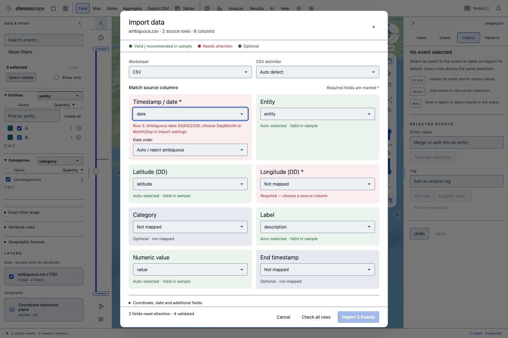
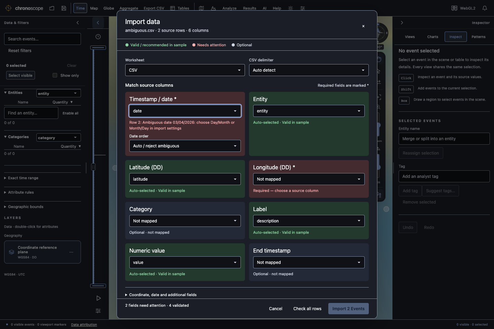
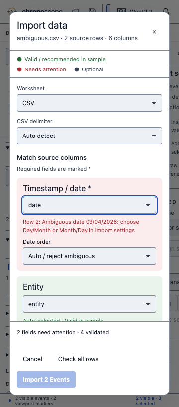

# Single-window import field grid

Developed from fresh Next main `6d1937c`. Pending Next branches were checked; the remaining historical AI branch is superseded by the focused-AI integration already on main. Public promotion is explicitly held. No hosted workflows or runners were dispatched, and workflows remain manual-only.

The three-step import wizard is replaced by one scrollable field-grid window. Sample-validated automatic and manual mappings are green; required missing mappings and validation errors are light red. Optional unmapped fields are neutral. Each card gives a text explanation. Date order stays beside the timestamp. Coordinate/date settings, aggregation, worksheet drafts, source preview, append/replace, rejection export and explicit rejection acceptance remain available in the same window.

Field feedback uses independent probes through the real Rust import converters, bounded to the first six source rows, so an invalid timestamp cannot hide coordinate or numeric errors. Colors explicitly describe sample validation. The full-file check remains required before committing. Editing mappings/options invalidates that check immediately; delayed sample responses cannot replace newer results. Independent valid cards stay green while an edited field is checked. A full check started before the sample debounce finishes also completes sample feedback. Delimiter changes preserve append mode. Saved worksheet mappings retain their own drafts.

Local validation:

- Full core Rust regression suite: 427 passed, one existing bundled-data matrix ignored. After the final feedback-wording adjustment, the three field-feedback and six import-review tests passed again.
- Strict core Clippy across all targets with `-D warnings`, formatting, CLI build, generated contract check and production TypeScript/Vite build passed.
- Frontend unit suite: 70 passed. Validation-runner unit suite: 20 passed.
- Final real CLI/browser checks: eight import-grid journeys, nine guided-workflow journeys and three import/view/save/open integration journeys passed. Browser checks recorded zero uncaught page errors and zero public requests.
- The grid was inspected in light/dark themes and at 960, 600 and 360 px widths. Its body scrolls while header/footer stay visible, with no outer or horizontal dialog overflow. The source table retains its own horizontal scrolling.

The new suite is available as `npm --prefix frontend run test:import-grid` after building the CLI/frontend. On this Mac the final browser run used `CHRONOSCOPE_QA_ANGLE=swiftshader`. The harness sets ISO display formatting explicitly so its UTC assertions do not depend on system locale. See [results.json](results.json) for the exact final browser checks.

