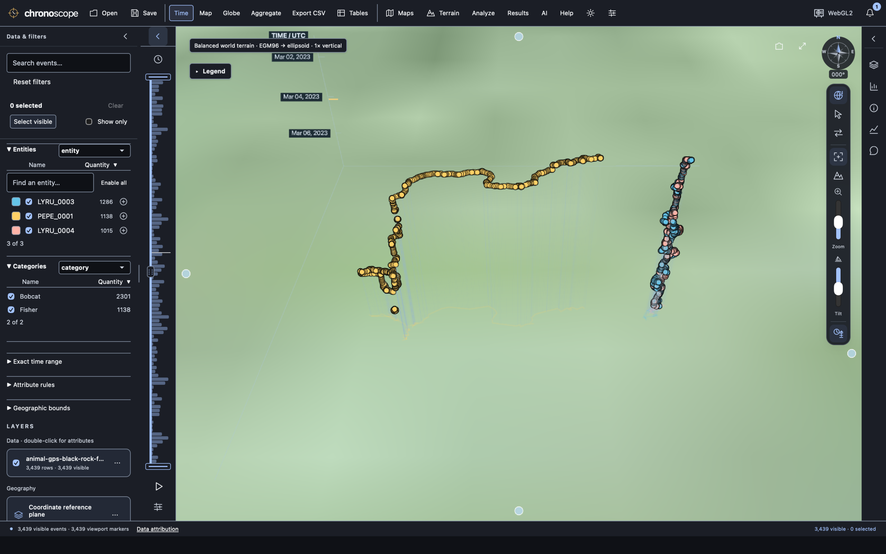
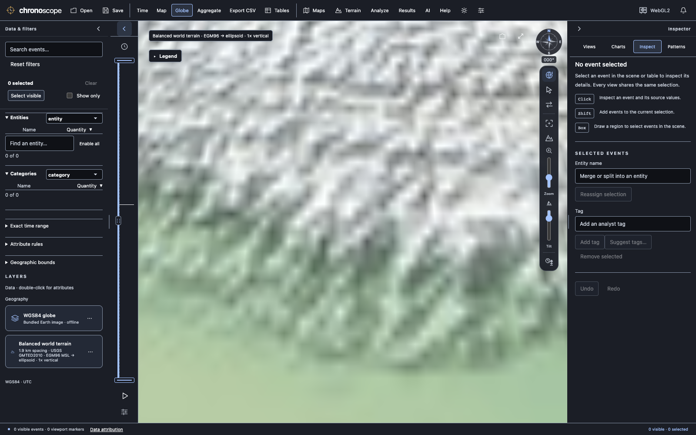

# Consolidated Next on macOS — 25 October 2026

The first latest-source build exposed a real integration omission: Next main
`4df308e` contained Balanced terrain and the idle-camera workaround, but omitted
the two completed commits `84f7662` and `27d1c9f` on
`codex/guided-analysis-import`. Those commits contain the expanded Time geography,
view synchronization, independent cameras, demo thumbnails, welcome workflow,
guided analyses, staged import review, and full-selection double-click fix.

The local merge `eb56541` retains both histories. The GitHub audit covered all five
Next branches and both PRs: vector imports and focused AI were already merged;
the terrain branch matched main. Available cloud handoffs corroborated the terrain
history. The separate upstream Cesium getter PR is not a missing Chronoscope
dependency update. This audit cannot establish the existence of unpublished work
on an unavailable workstation.

## Local results

[Machine-readable results](report.json) record the final outcomes and actual app
and terrain hashes. Detailed logs, initial failures, profiles and captures remain
in the ignored `.qa/mac-latest-20261025/` directory.

- **401 Rust tests** and **27 frontend tests** pass. Strict core/native Clippy,
  Rust formatting, generated contracts and the validation inventory pass.
- The app builds through `script/build_and_run.sh`, passes strict ad hoc signature
  verification and process verification, and opens using an isolated test profile.
  The packaged executable passes the real headless CLI/agent/stdio-MCP smoke test.
- All **15 selected browser suites** pass after the focused fixture corrections
  below: Balanced terrain, expanded Time geography, view sync, navigation, guided
  workflows, welcome, presentation, custom DTED, WKT/WMTS, basemap, viewport pan,
  playback transitions, renderer recovery, focused AI, and real demos.
- **93 packaging tests** pass: distribution 23, tester staging 34, final-download
  validation 36. Hosted workflows remain manual-only; none were dispatched.

## Actual terrain and native app

The running native engine reports the terrain path inside the built app's
`Contents/Resources/terrain/` directory. Its 88,778,304-byte pack matches SHA-256
`f93cdd806f477ebf73edb20212cd54089ea8b024cb2e4ba78e488554aa9377f8`;
receipt and every archive CRC pass.

Ten attached native checks pass, including Himalaya Globe/Map/Time scenes, both
polar regions, custom DTED and the real 3,439-event wildlife demo. They settle with
0–2 draws per 1.3-second measurement and no render errors. The wildlife Time scene
settles to zero draws. These are settling checks, not controlled FPS benchmarks.

The browser terrain suite finishes all six scenes with **zero draws per
1.2-second idle measurement**, visible attribution, zero renderer errors and zero
external requests. Unload survives restart; menu Restore works; saved workspaces
retain built-in identity without copying the world pack (720 bytes for the empty
browser workspace; 357,032 bytes for the native wildlife workspace). Custom DTED
replaces built-in terrain, requires an explicit datum, and survives portable
save/open. Native tests verify the same replacement and datum behavior.

## Fixture corrections and limits

The new terrain default required explicit fixture choices: the fixed screen-space
projection oracle disables terrain to retain its original ellipsoid-plane
measurements; the custom-DTED fixture explicitly selects the external source; the
imagery suite starts flat before its existing custom-terrain phase. All existing
interaction, pixel, source-data, selection and export assertions remain.

The terrain-only suite now enters the empty workspace through Welcome before
measuring visible pixels or using renderer credits, and uses Metal on macOS,
consistent with the other Mac suites. Its continuous mode transitions and all six
scene assertions remain. Earlier hidden-dialog failures and browser exits are
retained rather than relabeled as passes. The local runner also creates supplied
profile folders; native test code respects the MCP file scope and unwraps nullable
MCP results correctly. These latter issues were test-harness mistakes.

This verifies a local development app on this Mac. It does not establish Windows
or Linux acceptance, notarized-download acceptance, survey accuracy, paid-model
quality or smartcard behavior. Focused-AI browser checks use their local mock
provider. Public promotion is separate and was not performed.
