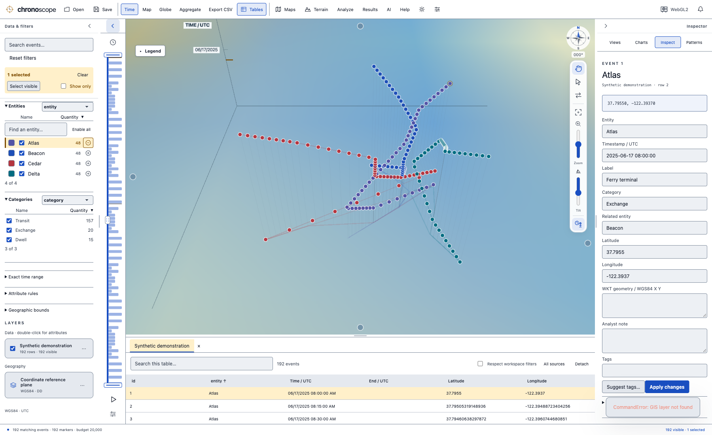

# Continuous columns and table-local search — 26 October 2026

Validated product source: `3f14dfea5cfd4435ca408e3db86ad098abcba954`.

Event and GIS tables now expose one continuous horizontal scroll range. Column
names and values are requested in bounded windows near the viewport, with spacer
columns retaining the full scroll extent. No Previous/Next fields controls remain.
The API's existing supported-source-column bounds remain unchanged.

Each left-aligned tab is the table's only visible title and contains its own close
button. The duplicate close/title row is replaced by a search box. Search examines
record text and original attributes across the whole table, including unloaded
columns. It combines with the workspace filter when Respect workspace filters is
enabled, without changing that filter. Searches and scroll positions remain local
to their tabs through switching, scene restoration, detachment and docking.
Keyboard/range selection uses the same searched ordering and remains responsive
while ordinary row/column refreshes are pending. Stale rows cannot be clicked while
changing search/scope.

## Coordination

Work started on `codex/table-continuous-columns-search`, after fetching Next.
Clawcomp explicitly acknowledged the user's Public promotion hold. Its test-only
commit `73eaf07` and final receipt `1f43bd7` were merged before integrating the UX
into Next main. Its new column/scroll/anchor/display-cell assertions are retained
and adapted to continuous scrolling. The existing Linux receipt remains pinned to
its earlier frozen source; it does not certify this subsequent UX update. Public
was not changed, and no hosted workflows were dispatched.

## Local verification

- Full core Rust run: **423 passed, zero failed**. One pre-existing full bundled-data
  matrix test remains ignored by the normal suite; no skips were added.
- Frontend unit tests: **70 passed**.
- Final real-engine browser suites: **15 table**, **14 Event table**, **24 GIS**
  checks passed. Includes far-right Event/GIS fields, bounded network projections,
  search in unloaded attributes, tab-specific searches, exact searched range
  selection, scene restore, both scroll axes, detach/dock/reload and native-style
  close. A loading-guard keyboard timing failure was corrected and the final Event
  navigation/range suite rerun successfully.
- Strict desktop Clippy, TypeScript/Vite build, generated contracts, Rust formatting
  and validation inventory pass. The final native bundle builds, passes strict ad
  hoc signature verification and launches through `script/build_and_run.sh --verify`.
- Native macOS UI checks show one tab title and a search row. Searching **Alex**
  narrows the hurricane table to **42 records** while the workspace remains at
  **3,568 visible Events**. Detach and Dock retain that query and count.

[Machine-readable results](result.json) · [Tables](tables.json) ·
[Events](events.json) · [GIS](gis.json)

Detailed logs, initial failed runs and disposable profiles remain in ignored
`.qa/`. Linux validation of the new UX and any later Public promotion are separate.
